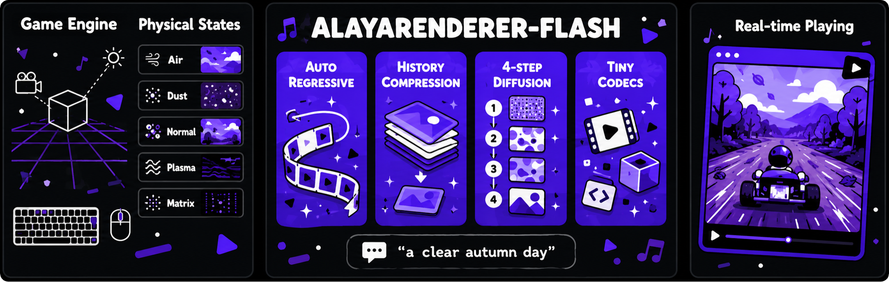

<h1 align="center">AlayaRenderer-Flash</h1>

<p align="center"><b>Generative World Renderer at the Speed of Play</b></p>

<p align="center">
  <a href="https://arxiv.org/abs/2607.18703"></a>
  <a href="https://alaya-renderer-flash.alayalab.ai"></a>
  <a href="https://huggingface.co/AlayaLab/AlayaRenderer-Flash"></a>
  <a href="https://github.com/AlayaLab/AlayaRenderer-Flash/actions/workflows/ci.yml"></a>
  <a href="LICENSE"></a>
  <a href="https://github.com/astral-sh/ruff"></a>
</p>

<p align="center"></p>

AlayaRenderer-Flash is the real-time version of
[AlayaRenderer](https://alaya-studio.github.io/renderer/). The game engine keeps
simulating the world and exports G-buffers (albedo, depth, metallic, normal,
roughness). AlayaRenderer-Flash renders them into RGB frames in a style you set
with a text prompt, at playback rate. This repository has the inference code,
the released SuperTuxKart model, and the playable demo behind the
[live site](https://alaya-renderer-flash.alayalab.ai).

## Features

- **Streams indefinitely.** An autoregressive renderer with a compressed long/mid/short latent history.
- **Renders in 4 steps.** Distilled from a 50-step teacher, with classifier-free guidance folded into the model.
- **Uses lightweight codecs.** A grouped G-buffer encoder and a stateful tiny decoder replace the Wan VAE.
- **Runs in real time.** The model renders at about 31 FPS on one H200, and the full game loop holds 30 FPS.
- **Plays live.** SuperTuxKart integration with a web UI, prompt-driven style switching, and keyboard control.

## Installation

You need Linux, an NVIDIA GPU with driver 570 or newer (CUDA 12.8), and
[uv](https://docs.astral.sh/uv/).

```bash
git clone https://github.com/AlayaLab/AlayaRenderer-Flash.git
cd AlayaRenderer-Flash
uv sync                       # Python 3.12 + PyTorch 2.11 (CUDA 12.8) + locked dependencies
uv sync --extra demo          # also install OpenCV for the live SuperTuxKart demo
```

To use it as a library in an existing environment:
`uv pip install "git+https://github.com/AlayaLab/AlayaRenderer-Flash.git"`.

## Quickstart

```bash
uv run python examples/fetch_samples.py      # two recorded SuperTuxKart G-buffer windows
uv run alayarender-flash render samples/window-00.npy samples/window-01.npy \
    --prompt "heavy snow at night, warm street lights, cinematic" -o snow.mp4
```

The weights download from the Hugging Face Hub on first use. To use local
copies instead, pass `--checkpoint` / `--base-model` or set `ALAYA_CHECKPOINT` /
`ALAYA_BASE_MODEL`. On GPUs with less than about 24 GB, add `--text-encoder-cpu`.

From Python:

```python
from alayarenderer_flash.render import OfflineRenderer, load_gbuffer_stream
from alayarenderer_flash.runtime import RuntimeConfig
from alayarenderer_flash.weights import resolve_base_model, resolve_checkpoint

config = RuntimeConfig(base_model=resolve_base_model(), checkpoint=resolve_checkpoint())
renderer = OfflineRenderer(config)
frames = renderer.render(load_gbuffer_stream(["samples/window-00.npy"]), "golden hour, warm haze")
```

G-buffer inputs are uint8 arrays of shape `(T, 5, 448, 832, 3)` in the order
albedo, depth, metallic, normal, roughness. They are rendered causally: 13
frames for the first chunk, then 16 per chunk.

## Live demo

Play SuperTuxKart through the renderer in your browser:

```bash
cp examples/deploy.env.example deploy.env          # set the STK binary and weight paths
uv run alayarender-flash serve --config deploy.env doctor --json
uv run alayarender-flash serve --config deploy.env start
```

See [docs/demo.md](docs/demo.md) for the full setup. The demo needs a SuperTuxKart
build with G-buffer export, which is not distributed here; see
[integrations/supertuxkart](integrations/supertuxkart/).
[docs/architecture.md](docs/architecture.md) describes how the pieces fit together.

## Model zoo

| Model | Domain | Steps | Resolution | Weights |
|---|---|---|---|---|
| AlayaRenderer-Flash (checkpoint-600) | SuperTuxKart | 4 | 832×448 | [🤗 AlayaLab/AlayaRenderer-Flash](https://huggingface.co/AlayaLab/AlayaRenderer-Flash) |

It needs the base model [Wan-AI/Wan2.1-T2V-1.3B-Diffusers](https://huggingface.co/Wan-AI/Wan2.1-T2V-1.3B-Diffusers)
for the text encoder, tokenizer and VAE configuration.

## Results

Evaluation set from the [technical report](https://arxiv.org/abs/2607.18703):
131 clips × 150 frames at 832×448 on one H200.

| Method | Steps | S<sub>CLIP-I</sub> ↑ | Boundary SSIM ↑ | tLPIPS<sub>warp</sub> ↓ | FPS ↑ | VRAM (GB) ↓ |
|---|---|---|---|---|---|---|
| AlayaRenderer | 50 | 0.836 | 0.308 | **0.124** | 0.56 | 30.1 |
| **AlayaRenderer-Flash** | 4 | **0.847** | **0.430** | 0.155 | **31.54** | **16.2** |

## Development

```bash
uv run pre-commit install
uv run ruff format . && uv run ruff check .
uv run pytest -q
```

See [CONTRIBUTING.md](CONTRIBUTING.md).

## Citation

```bibtex
@article{lin2026alayarendererflash,
  title   = {Generative World Renderer at the Speed of Play},
  author  = {Lin, Guixu and Huang, Zheng-Hui and Yang, Siqi and Yang, Ming-Hsuan and Zhang, Kaipeng and Wang, Zhixiang},
  journal = {arXiv preprint arXiv:2607.18703},
  year    = {2026}
}
```

## License

The code is licensed under the [Apache License 2.0](LICENSE); attributions are
in [NOTICE](NOTICE), and third-party code, dependencies and media are listed in
[THIRD_PARTY_LICENSES.md](THIRD_PARTY_LICENSES.md). Exceptions:

- SuperTuxKart (GPL-3.0-or-later) is not part of this repository: its source,
  binaries, modifications and game assets are not distributed here, nor are
  images rendered from SuperTuxKart scenes.
- `src/alayarenderer_flash/decoders/taehv.py` is MIT-licensed (TAEHV); see
  [LICENSES/TAEHV-MIT.txt](LICENSES/TAEHV-MIT.txt).
- The model weights are released under the license in the
  [model repository](https://huggingface.co/AlayaLab/AlayaRenderer-Flash);
  downloads are pinned to a fixed revision in `src/alayarenderer_flash/weights.py`.

## Acknowledgements

This project builds on [Wan 2.1](https://github.com/Wan-Video/Wan2.1),
[Helios](https://github.com/PKU-YuanGroup/Helios),
[TAEHV](https://github.com/madebyollin/taehv),
[Diffusers](https://github.com/huggingface/diffusers), and
[SuperTuxKart](https://supertuxkart.net).
